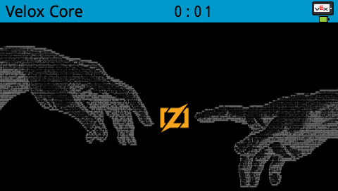

<h1 align="center">Velox</h1>

<strong>Embedded Zig Kernel for VEX V5.</strong>

  
  
  
  

## Getting Started

To get started using Velox, you must have the following software installed:

- Zig 0.16.x (see badge; CI uses latest Zig)
- Cargo + `cargo-v5` for uploading (temporary until a native uploader exists)

Create a project and wire Velox as a dependency in `build.zig`/`build.zig.zon`. A project template script is not currently shipped in this repository.

## Roadmap

- [x] Write boot code
- [x] Custom Allocator Override
- [x] Panic handler with stack traces
- [x] Jumptable integration
- [x] Device Drivers (_partially done_)
- [ ] Custom Uploader program
- [ ] GUI library written on top of [Zigui](https://github.com/ddalcu/zigui)

#### Additional work

- [ ] Refactor `velox-jumptable` to just read from C header files and map memory addresses instead of generating bindings
- [ ] Refactor `velox-jumptable` into this monorepo

## Competition Legality

Velox should be 100% legal. It is simply a framework for writing user programs.

## Licensing

Velox's original code is licensed under the MIT license, **however, `umm-zig` is licensed under the Zlib license, and therefore `velox-umm` is licensed under Zlib as well**.

## Acknowledgements

This project would not have been possible without the research from these projects and teams:

- [PROS](https://pros.cs.purdue.edu/)
- [Vexide](https://vexide.dev/)
- [38535B High Stakes Source](https://github.com/tubaplayerdis/Gold4Team3CompProj)
- [vex-v5-research](https://github.com/hatf0/vex-v5-research/tree/master)
- [VEXAPI](https://github.com/cetio/VEXAPI)

Velox builds on their research into the Brain's memory model and configuration.

## Tests

> [!WARNING]
> When cloning this repository to run unit tests, preserve symlinks, especially on Windows.

`zig build test` builds an on-hardware test artifact (`zig-out/bin/velox-test`) using the kernel + runner shim. Upload it to a V5 brain and monitor serial output to see results.

> [!NOTE]
> Because we don't have a V5 brain as a CI test runner, on-hardware tests are not executed in CI.
